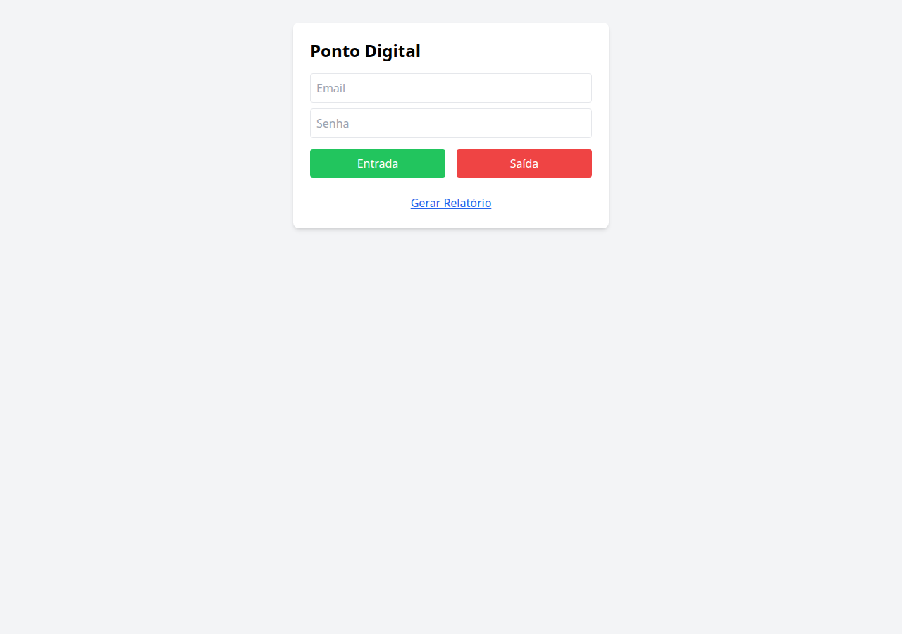

# Ponto Digital — frontend

Tela para o funcionário bater ponto e consultar o próprio histórico. Informa e-mail e senha, registra entrada ou saída e gera um relatório com tipo, data/hora e IP.

Feito em React, TypeScript e Vite. As chamadas vão para a API do repositório `ponto-backend` (`POST /punch` e `GET /report/:email`). A URL da API está fixa em `src/App.tsx` como `https://seu-backend-na-render.com`. Esse nome não resolve no DNS; a constante precisa apontar para o backend publicado.

## Demonstração

Não há demo pública. O endereço que estava neste README e no campo About do GitHub (`pontofrontend.vercel.app`) responde 404 com o erro `DEPLOYMENT_NOT_FOUND` da Vercel: não existe deploy nesse domínio. Publicar de novo depende da conta Vercel do dono do repositório, não só deste código.

Para ver a tela nesta máquina:

```bash
npm install
npm run dev
```

Abra o endereço que o Vite mostrar (em geral `http://localhost:5173`).



Entrada, saída e o relatório só respondem com o `ponto-backend` no ar e com a URL da API atualizada. Sem isso, a tela abre e a chamada falha.

Para publicar de novo na Vercel, importe este repositório com preset Vite, comando de build `npm run build` e diretório de saída `dist`. O build não usa variável de ambiente. Para reaproveitar o domínio antigo, o nome do projeto na Vercel precisa ser `pontofrontend`. Se esse nome não estiver disponível, use a URL que a Vercel gerar e coloque-a no campo Website do About do GitHub.
